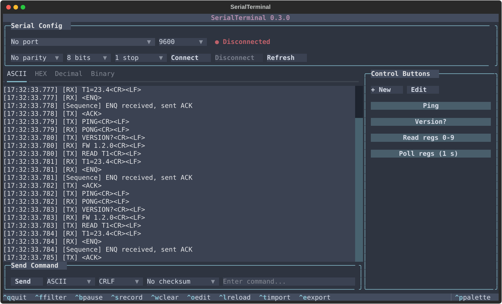
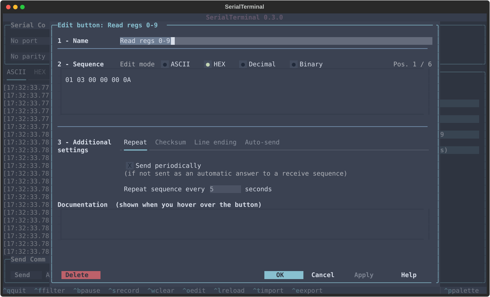

# SerialTerminal

A terminal UI for talking to serial devices: send and receive in ASCII, hex,
decimal and binary, drive the device from your own buttons, and answer incoming
frames automatically. Built for embedded work where a plain serial monitor
isn't enough. Runs on Windows, macOS and Linux.



## Features

* **Four-notation log** - every frame in ASCII, HEX, Decimal and Binary tabs,
  with control characters named (`<CR>`, `<ACK>`); filter, pause and record.
* **Buttons** - saved commands with an editor modelled on Docklight's; optional
  checksum, line ending, repeat (marked ↻) and auto-send on a matching frame.
* **Sequences** - pattern-matched automatic replies, with `??` wildcards.
* **Checksums** - sum8, xor8, lrc8, CRC-16/MODBUS, CRC-16/CCITT.
* **Docklight import** - `.ptp` projects become buttons and sequences.
* **Send Command** with live validation and shell-style history (Up / Down).
* **Auto-connect** on send; port loss is detected and reported.
* **Settings** (`F2`) - theme, log colors, frame gap, verbose errors.



## Install

Python 3.10 or newer.

```bash
pip install .
```

```bash
serialterminal
```

`python -m serialterminal` also works. On macOS and Linux use `pip3`/`python3`;
on Linux, join the `dialout` group to open ports (see
[Platform notes](docs/guide.md#platform-notes)).

## Quick start

1. Copy `project.example.yml` to `project.yml`, or load it with `Ctrl+T`.
2. Pick the port and line settings at the top.
3. Type in **Send Command** or press a button - it connects as needed.

## Shortcuts

| Key | Action |
| --- | ------ |
| `Ctrl+N` | New button (right-click a button to edit it) |
| `Ctrl+F` | Filter the log |
| `Ctrl+B` | Pause / resume the log |
| `Ctrl+S` | Record the session to a file |
| `Ctrl+W` | Clear the log |
| `Ctrl+T` / `Ctrl+E` | Import / export a config (`.yml`, Docklight `.ptp`) |
| `Ctrl+O` / `Ctrl+L` | Edit / reload `project.yml` |
| `F2` | Settings |
| `F3` | Show / hide recent projects (left; hidden at start) |
| `F4` | Show / hide the control buttons (right) |
| `Ctrl+Q` | Quit |

## Files

* `project.yml` - serial settings, buttons and sequences. Holds your device's
  commands, so it's git-ignored.
* `settings.yml` - this machine's preferences (theme, colors, recent files).
* `serialterminal.log` - diagnostics; record traffic with `Ctrl+S` instead.

## More

* [Guide](docs/guide.md) - the interface in detail, config reference,
  sequences, checksums, platform notes, troubleshooting.
* [Development](docs/development.md) - tests, project layout, known gaps.
* [Changelog](CHANGELOG.md)

## License

MIT - see [LICENSE](LICENSE).
