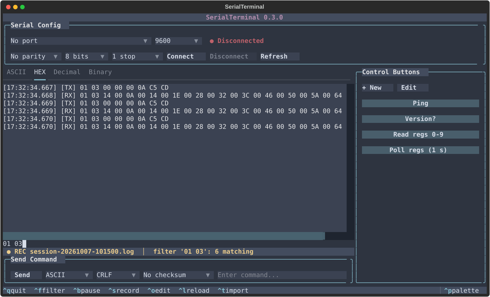

# SerialTerminal guide

Everything the [README](../README.MD) leaves out: the interface in detail, the config files, sequences, checksums, platform notes and troubleshooting.

* [Interface](#interface)
* [Configuration](#configuration)
* [Platform notes](#platform-notes)
* [Troubleshooting](#troubleshooting)
* [The `serialterminal` command and PATH](#the-serialterminal-command-and-path)

## Interface

| Area | What it does |
| ---- | ------------ |
| **Serial Config** | Port, baud, parity, data bits, stop bits, connect/disconnect, rescan ports (opening the port list rescans too) |
| **Log** | Four tabs — ASCII, HEX, Decimal, Binary — showing the same traffic in each notation, with filter, pause and recording |
| **Send Command** | One-off send: format, line ending, checksum, and live validation of what you type |
| **Control Buttons** | Your saved commands: create and edit them in the button editor; optionally repeating or sent automatically in reply to a received frame |

Every frame is written to all four tabs with one shared timestamp, prefixed
`[TX]`, `[RX]`, `[Error]` or `[Sequence]`. The ASCII tab names control
characters (`<STX>`, `<ACK>`, ...) and keeps line terminators visible, so you
can see whether a device sent `<CR><LF>`, `<LF>` or `<CR>`; a new line starts
after each one.

Controls are one row tall and meant for the mouse, so most of the screen goes
to the log. To make everything bigger or smaller, zoom the terminal itself
(`Ctrl` + `+`/`-` or `Ctrl` + mouse wheel in Windows Terminal); the app has
no font size of its own.

**Side panels.** **Recent projects** (`F3`) sits on the left, collapsed at
start: it lists the project files you imported or exported, newest first, and
clicking one imports it as `Ctrl+T` would (the current one is backed up to
`project.backup.yml`). The control buttons (`F4`, or the » in their toolbar)
are shown at start and can be hidden; repeats keep running while hidden. A
collapsed panel leaves a thin strip with its name written downwards - click
it to open the panel again.

**Layout.** At 100 columns or more, control buttons sit in a sidebar to the
right of the log, so they never take rows from it. Narrower than that, a
sidebar would leave the log too thin for a hex frame, so the buttons move under
the log instead, capped at about a third of the height. Either way the panel
scrolls when there are more buttons than fit. Labels longer than about 25
characters are shortened with `…`; hover a button to see it in full. Under 30
rows the title line and spacing give way to log rows.

**Button editor.** Create a button with **+ New** (or `Ctrl+N`); edit one by
right-clicking it, or switch on **Edit** mode and click it - Edit mode is there
for terminals and trackpads that keep the right button to themselves. Changes
go straight into `project.yml`.


It follows Docklight's sequence definition:

* **1 - Name** - the button's label.
* **2 - Sequence** - what it sends. **Edit mode** switches between ASCII, HEX,
  Decimal and Binary and converts the sequence as you switch. In ASCII mode,
  control characters are written by name - `<CR>`, `<LF>`, `<STX>`, `<ACK>` -
  the same names the log uses; use HEX for bytes above 7F. **Pos.** shows the
  byte under the cursor and the total.
* **3 - Additional settings**
  * *Repeat* - send every N seconds while toggled on. Repeating buttons are
    marked ↻ (or `[R]`, see below).
  * *Checksum* - computed over the sequence and appended.
  * *Line ending* - added after the checksum; ASCII sequences only.
  * *Auto-send* - also send this button whenever a matching frame is received
    (`??` matches any byte), optionally after a delay. Its checksum and line
    ending apply.
* **Documentation** - shown when you hover over the button.
* **Delete** (two clicks), **OK**, **Cancel**, **Apply** (save, stay open),
  **Help**.

Editing a button leaves other buttons' repeats running.

**Connecting.** Pressing a button or sending a command while disconnected
connects first, with the settings shown, so there's no need to press Connect.
If no port is selected or it won't open, the log says why and nothing is sent.
Changing the port, or the baud rate, parity, data bits or stop bits, while
connected disconnects (the open port would otherwise keep the old settings);
the next send reconnects with the new ones. If the device goes away - unplugged
or reset - the log says so once, the status switches to Disconnected, repeating
buttons stop, and the next send reconnects.

**Colors.** Sent, received, system, error and sequence-reply lines each have
their own color, from the theme by default. Change them, and the theme, in
**Settings** (`F2`). Settings apply and save as you change them; if a file
can't be written, a notification says so.

**Errors.** A serial-port problem shows as one short line, such as
`Error: couldn't open COM4` or `Error: send failed`. Turn on **Verbose COM
errors** in Settings to also see the system's message and what to try (for
example, joining the `dialout` group on Linux). The full detail is always in
`serialterminal.log`.

**Send Command.** The input is checked as you type against the selected
format: a red border and a reason (`'G' is not a hex digit`) mean it would not
send. A failed send keeps your text, including a write the port refused (an
unplugged adapter); only a successful one clears the box, and `[TX]` is logged
only for bytes that actually went out. The format, line ending and checksum you
pick are saved in `project.yml`. **Up** and **Down** in the box step through
the commands you sent before, each with its format, like a shell's history;
Down past the newest brings back what you were typing. The last 100 are kept
in `settings.yml`.

**Filter** (`Ctrl+F`). Shows only log entries containing the text,
case-insensitive. Each tab matches its own notation, so `41 42` finds a frame
on the HEX tab and `AB` finds it on the ASCII tab. Timestamps are not searched;
the direction tag is, so `[RX]` shows only received frames. The status line under the log
gives the match count for the current tab. `Esc` or `Ctrl+F` again closes the
filter and brings everything back.

**Pause** (`Ctrl+B`). Freezes the view so you can scroll and read while traffic
keeps arriving. Nothing is lost: entries are still recorded (and captured, if
recording) and appear when you resume. The status line counts what arrived
meanwhile. Each tab keeps its last 20,000 entries for filtering and resuming.

**Record** (`Ctrl+S`). Asks for a file (default `session-YYYYMMDD-HHMMSS.log`)
and appends every log entry to it until you press `Ctrl+S` again or quit. An
existing file is appended to, never overwritten. Timestamps match the screen.
Lines look like:

```
2026-10-06 16:07:23.286 TX   01 03 00 00 00 0A C5 CD  |........|
2026-10-06 16:07:23.544 RX   50 4F 4E 47 0D 0A  |PONG..|
```



**Recent files and favorites.** The import, export and record dialogs have a
**Recent files** list (the last ten configs imported or exported, or recordings
made) and a **Favorites** list. **☆ Folder** adds the folder you're looking at;
**☆ File** adds the file named in the box; press again (★) to remove. Picking a
file in an open dialog opens it straight away; in a save dialog it goes to its
folder and fills in the name. Dialogs start in the folder of the last file used.
Both lists live in `settings.yml`.

### Keyboard shortcuts

| Shortcut | Action |
| -------- | ------ |
| `Ctrl+Q` | Quit (saves config and settings) |
| `Ctrl+W` | Clear the log |
| `Ctrl+O` | Open `project.yml` in `$VISUAL`/`$EDITOR` (Notepad on Windows), then reload |
| `Ctrl+L` | Reload `project.yml` |
| `Ctrl+T` | Import config (`.yml`, `.yaml`, or Docklight `.ptp`) |
| `Ctrl+N` | New button (opens the button editor) |
| `Ctrl+E` | Export current config to a `.yml` file |
| `Ctrl+F` | Filter the log; `Esc` closes |
| `Ctrl+B` | Pause / resume the log view |
| `Ctrl+S` | Start / stop recording the session to a file |
| `F2` | Settings: theme, log colors, frame gap, repeat marker, verbose errors |
| `F3` | Show / hide recent projects |
| `F4` | Show / hide the control buttons |
| `Ctrl+R` | Reload `styles.tcss` (not shown in the footer) |

`Ctrl+W` and `Ctrl+E` don't work while a text box has focus, because the box
uses them for delete-word and end-of-line. Click elsewhere or press `Tab`
first. See [Known gaps](development.md#known-gaps).

---

## Configuration

Two files, with different jobs:

* **`project.yml`** — the working config: serial settings, quick-send options, buttons, sequences.
  Git-ignored, because it holds your device's commands and the app rewrites it.
  Start from the shipped example:

  ```bash
  cp project.example.yml project.yml
  ```

  or load `project.example.yml` with `Ctrl+T`. To share a config, export a copy
  with `Ctrl+E`; `Ctrl+T` imports one (YAML or Docklight `.ptp`).
* **`settings.yml`** — per-machine preferences: theme, log colors, repeat marker, recent files
  and favorites. Not committed; copy `settings.example.yml` to start. Created
  with defaults on first launch if missing.

  ```yaml
  ui:
    theme: gruvbox
  verbose_errors: false  # true: COM errors include the system message and a hint
  repeat_marker: auto  # symbol (↻), text ([R]) or auto - see Repeating buttons
  log_colors:          # optional; set from Settings (F2)
    tx: $primary       # a theme color ($primary, $success, $warning, $error,
    rx: $success       # $accent, $foreground, $foreground-muted...) or #RRGGBB
    system: $foreground-muted
    error: $error
    sequence: $warning
  ```

The theme lives in `settings.yml` only, so exporting a project doesn't carry your
colour scheme to whoever opens it. A `ui.theme` left in an older `project.yml` is
still honoured once, then dropped on the next save.

`project.yml` is rewritten on connect and on exit, so hand-edits to the `serial`
section are overwritten by whatever the widgets currently show.

**Mistakes in `project.yml` are reported, not fatal.** Problems appear as
`[Error]` lines in the log at startup and on every reload:

* If the file can't be read at all (a YAML syntax error, or a top level that
  isn't a mapping), the app starts with an empty config and **will not save over
  the file**, so a typo never costs you its contents. Fix it (`Ctrl+O`) and
  reload (`Ctrl+L`).
* A button entry that isn't a mapping is skipped. A missing, duplicate or
  illegal `id` (ids are letters, digits, `-` and `_`, not starting with a
  digit) is replaced on screen with a legal unique one; your file keeps what you
  wrote. A `repeat` that isn't a number makes the button one-shot.
* A malformed sequence is skipped and the rest still load.

### Serial

```yaml
serial:
  port: COM4          # or /dev/ttyUSB0; `none` means nothing selected
  baud_rate: 9600
  parity: N           # N, E, O, M, S
  data_bits: '8'      # 5, 6, 7, 8   (quoted - these are strings)
  stop_bits: '1'      # 1, 1.5, 2
  frame_gap: auto     # or milliseconds, e.g. 100 - see Troubleshooting
```

All fields are restored on launch. If a saved port is gone (adapter unplugged)
the log says so rather than connecting to something else.

### Quick send

Written from the Send Command bar on exit and on connect; restored on launch.

```yaml
quick_send:
  format: hex            # ascii | hex | decimal | binary
  line_ending: none      # none | cr | lf | crlf
  checksum: crc16_modbus # see Checksums and line endings
```

### Buttons

```yaml
buttons:
  - id: ping             # required, must be unique - it becomes the widget id
    label: Ping          # button text
    message: 'PING'
    format: ascii        # ascii | hex | decimal | binary
    line_ending: crlf    # optional, default none
    checksum: none       # optional, default none
    tooltip: Send a ping  # optional; the editor's Documentation box
    repeat: 1000         # optional: ms between repeats; omit or 0 for one-shot
    auto_send:           # optional: also send this when a matching frame arrives
      receive:
        data: '05'       # pattern; ?? matches any byte
        format: hex
      delay: 0           # ms to wait before sending
```

The button editor reads and writes exactly these fields; anything else in an
entry is kept as it is.

Use `line_ending` rather than writing `\r\n` into `message`. Inside single
quotes YAML keeps backslashes literally, so `'PING\r\n'` sends a
backslash, an `r`, a backslash and an `n`. Buttons use only their own
`checksum` and `line_ending`, never the Send Command bar's.

A button with `repeat` greater than 0 toggles: first press starts the interval
and highlights the button, second press stops it. Repeats also stop on
disconnect and on a config reload (`Ctrl+L`), but not when another button is
edited.

Repeating buttons are marked with ↻ in the accent color, before the label.
A terminal can't report whether its font has a glyph, so **Repeat marker** in
Settings (`F2`) defaults to *Auto*: ↻ in Windows Terminal, VS Code and macOS
and Linux terminals, which borrow it from a fallback font, and `[R]` in the old
Windows console and the Linux text console, which can't draw it. If you see a
box or `?` instead, choose `[R]`.

A button with `auto_send` works like a sequence whose reply is the button
itself - use whichever fits. Sequences are what a Docklight import produces.

### Sequences

Sequences watch received frames and answer automatically.

```yaml
sequences:
  - name: ACK Response     # required
    active: true           # optional, default true
    delay: 0               # optional, ms to wait before replying
    comment: ACK received  # optional, logged when the pattern matches
    receive:
      data: '06'
      format: hex          # hex | ascii | decimal | binary
    send:
      data: '06'
      format: hex
      checksum: none       # optional, as for buttons
      line_ending: none    # optional, as for buttons
```

The first matching active sequence wins; matching is a substring search, not a
whole-frame match.

**Wildcards.** `??` matches any single byte. How you write it depends on the
format:

| Format | Pattern | Matches |
| ------ | ------- | ------- |
| `hex` | `3A ?? 0D 0A` | one wildcard byte, space-separated tokens |
| `decimal` | `58 ?? 13 10` | same, in decimal |
| `binary` | `00111010 ???????? 00001101` | a full 8-bit `????????` group |
| `ascii` | `PRICE ??` | one wildcard character |

Everything that isn't a wildcard is matched literally, including regex
metacharacters — `PRICE $1.00` matches exactly that text.

A sequence that fails to parse is skipped on its own; the rest still load, and
the reload message reports how many were dropped. Details go to the log file.

### Checksums and line endings

The frame is built as: payload, then the checksum over the payload, then the
line ending. The checksum is appended as raw bytes. The line ending applies
to ASCII only: hex, decimal and binary frames go out exactly as written, so a
CRLF chosen for text never lands on a binary frame. The selector greys out to
show this.

| `checksum` | Algorithm | Bytes appended |
| ---------- | --------- | -------------- |
| `none` | — | none |
| `sum8` | 8-bit sum | 1 |
| `xor8` | XOR of all bytes | 1 |
| `lrc8` | Two's complement of the 8-bit sum | 1 |
| `crc16_modbus` | CRC-16/MODBUS (poly 0x8005 reflected, init 0xFFFF) | 2, low byte first |
| `crc16_ccitt` | CRC-16/CCITT-FALSE (poly 0x1021, init 0xFFFF) | 2, high byte first |

An unknown `checksum` or `line_ending` in `project.yml` means nothing is sent
when the button or sequence fires. A button reports it on screen; a sequence
reports it in `serialterminal.log`.

### Importing from Docklight

`Ctrl+T` on a `.ptp` file converts Docklight send/receive definitions into
buttons and sequences. Docklight's `##` data markers become `??` wildcards.
The current `project.yml` is backed up to `project.backup.yml` first.

The parser assumes the field layout of the `.ptp` files it was written against
and does no bounds checking, so an unexpected file shape will report an error
rather than import partially.

---

## Platform notes

**Windows.** Ports are `COM3`, `COM4`, ... "Access is denied" when connecting
means another program (a terminal, Docklight, a vendor tool) already has the
port open. `Ctrl+O` opens `project.yml` in Notepad unless `$VISUAL`/`$EDITOR`
is set.

**macOS.** Ports are `/dev/cu.usbserial-*` or `/dev/cu.usbmodem*`. Use the
`cu.*` devices, not `tty.*`, which wait for a carrier signal. `Ctrl+O` uses
`$VISUAL`/`$EDITOR`, then `nano`, then `vi`.

**Linux.** Ports are `/dev/ttyUSB*` (USB-serial adapters) and `/dev/ttyACM*`
(boards with native USB). Opening one needs membership of the serial group:

```bash
sudo usermod -aG dialout $USER
```

(`uucp` instead of `dialout` on Arch), then log out and back in. The app says so
if a port is refused. `Ctrl+O` uses `$VISUAL`/`$EDITOR`, then `nano`, then `vi`.

**All platforms.** Docklight `.ptp` files are read in the Windows ANSI encoding
they're saved in, so accented labels import correctly everywhere. Config files
are UTF-8.

---

## Troubleshooting

Diagnostics go to `serialterminal.log` (rotating, ~4 MB across 4 files) rather
than the screen, which the TUI owns. That file is about the app itself; to keep
the traffic, record a session with `Ctrl+S`. Tail it while reproducing:

```bash
tail -f serialterminal.log
```

**One message shows up as several lines, or several as one.** Received bytes
become one log entry until the line has been quiet for the **Frame gap** set in
Settings (`F2`). `auto` is 30 ms - longer than USB-serial adapters' bursts (an FTDI
chip delivers data every 16 ms by default) - or three character times at very
low baud rates, up to 200 ms. If a device pauses mid-message, raise the gap; if
separate messages run together, lower it. It applies immediately and is saved
with the project. A device that never pauses is shown in pieces of at most
4 KB or half a second.

---

## The `serialterminal` command and PATH

If `serialterminal` is not recognised after installing, the folder pip put it
in is not on your PATH. pip can't fix that itself (packages can't run code at
install time), so the app offers on its first launch:

```
The `serialterminal` command is installed in C:\...\Python314\Scripts,
but that folder is not on your PATH, so typing `serialterminal` won't find it.
Add it to your user PATH now? [y/N]
```

Answering `y` adds the folder to your **user** PATH (no admin rights needed),
keeping existing `%VAR%` entries intact. Open a new terminal afterwards. The
question is asked once; the answer is remembered in
`%LOCALAPPDATA%\SerialTerminal\state.yml` (macOS:
`~/Library/Application Support/SerialTerminal`; Linux:
`~/.local/state/serialterminal`). It isn't asked inside a virtual
environment, where activation manages PATH. On Linux and macOS it prints the
`export` line for your shell profile instead of editing it.

To do it any time, without the prompt:

```bash
python -m serialterminal --add-to-path
```

`python -m serialterminal` always works, PATH or not. `--version` prints the
installed version, which is also shown in the title bar.
